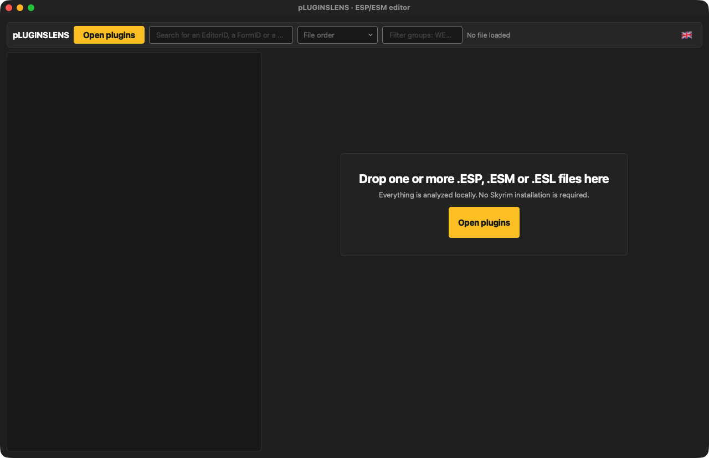
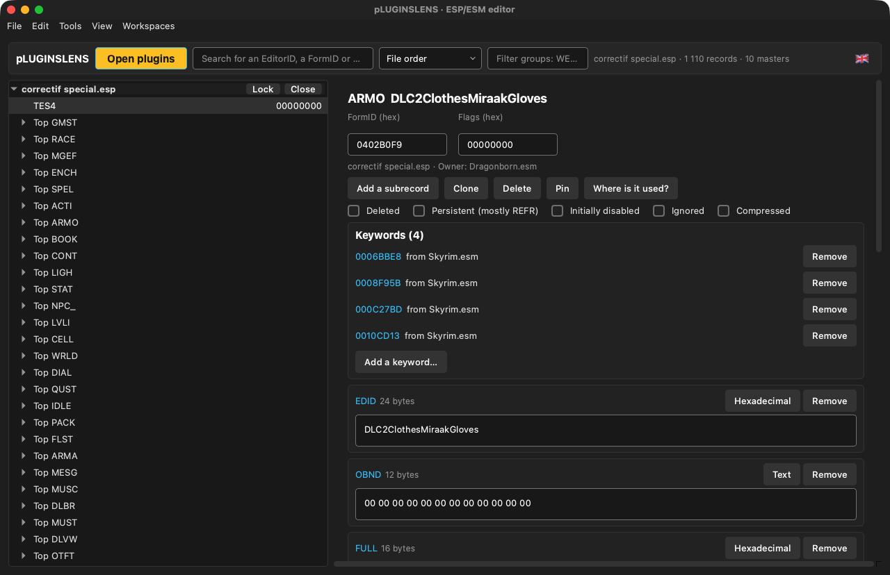
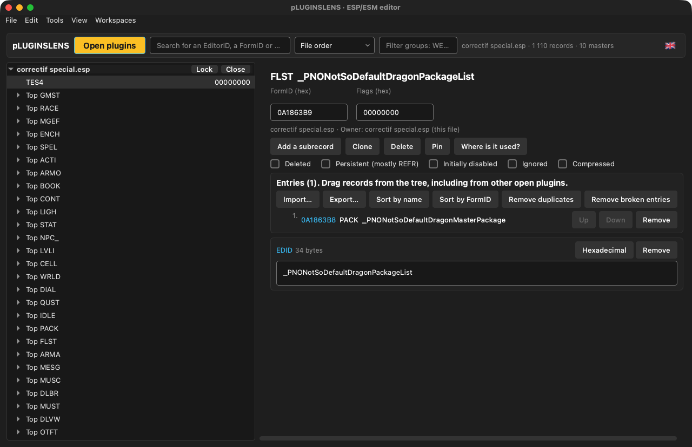

<p align="center"></p>

# pLUGINSLENS

**Skyrim plugin editor (.esp / .esm / .esl) for macOS: browse, compare and edit records.**  
*Éditeur de plugins Skyrim (.esp / .esm / .esl) pour macOS : parcourir, comparer et modifier les enregistrements.*

🇬🇧 [English](#-english) · 🇫🇷 [Français](#-français)

---
## 🇬🇧 English

### What it does

pLUGINSLENS is a lightweight plugin editor for the Mac: open several plugins, search records by EditorID, FormID or type, edit subrecords, FormLists, keywords and globals, and compare plugins — everything is analyzed locally, no Skyrim install needed. It is not a replacement for xEdit for heavy work, but covers everyday checks and small fixes.

### Features

- Open several plugins at once; tree by group, sort by file order, EditorID or FormID, group filter.
- Record sheet: FormID, flags (deleted, persistent, ESL…), owner plugin, every subrecord in text or hexadecimal.
- Dedicated editors for **FormLists** (import/export, sort, remove duplicates and broken entries), **keywords** and **global variables**.
- Add, clone or delete records and subrecords; copy and paste records between plugins.
- Tools: **Where is it used?**, duplicate finder, compare two plugins, side-by-side record comparison with drag-to-copy fields.
- Undo / redo, change log, lock a plugin to protect it, workspaces, session restore.
- Changes are saved as a **copy**: your original plugin is never overwritten.
- Interface in **English, French, Italian and Spanish** (follows your Mac's language; can be changed in the app).

### What's new in 1.3.0

- Signed with a Developer ID and notarized by Apple: macOS now opens the app without a security warning.
- The app's launcher is now compiled from source when the app is built, instead of using PyInstaller's generic prebuilt launcher, which antivirus scanners tend to flag. No change in features.
- The first letter of the app's name now uses the colour of its logo everywhere it appears.
- Version number aligned across the Skyrim Mac Toolkit.

### Updates

The app checks once a day whether a newer release exists on GitHub and offers to open the Nexus page, remind you later or skip that version. Nothing is downloaded or installed automatically. The full history is in [CHANGELOG.md](CHANGELOG.md).

### Screenshots


*Welcome screen*


*Record sheet with flags and keywords*


*FormList editor*

### Requirements

A Mac with **Apple Silicon** (M1 or later), **macOS 13 Ventura** or later. No Python, no Wine, no virtual machine needed.

### Installation

1. Download the zip from Nexus Mods (or from the GitHub releases) and unzip it.
2. Move **pLUGINSLENS.app** to your **Applications** folder.

### How to use

1. Drop one or more plugins on the window, or click **Open plugins**.
2. Browse the tree or search an EditorID / FormID; click a record to open its sheet.
3. Edit what you need; use **Edit → Undo** if needed, and **Tools** for comparisons and searches.
4. **File → Save a copy…** (⌘S) to write the modified plugin.

### FAQ

**Can I add a master to a plugin?**  
Only to plugins made of FormLists (other records would need renumbering): use xEdit for the others.

### Building from source

Requires Python 3.12 with PyQt6 and PyInstaller. From the repository folder:

```bash
./build_app.sh
```

### License

Released under the **MIT License**: free to use, modify and share. Part of the **Skyrim Mac Toolkit**, a set of modding tools built for Skyrim players on Mac.

---

## 🇫🇷 Français

### À quoi ça sert

pLUGINSLENS est un éditeur de plugins léger pour Mac : ouvrez plusieurs plugins, cherchez des enregistrements par EditorID, FormID ou type, modifiez les sous-enregistrements, FormLists, mots-clés et globales, et comparez des plugins — tout est analysé localement, sans installation de Skyrim. Il ne remplace pas xEdit pour les gros travaux, mais couvre les vérifications courantes et les petites corrections.

### Fonctions

- Plusieurs plugins ouverts à la fois ; arbre par groupe, tri par ordre du fichier, EditorID ou FormID, filtre de groupes.
- Fiche d'enregistrement : FormID, drapeaux (supprimé, persistant, ESL…), plugin propriétaire, chaque sous-enregistrement en texte ou en hexadécimal.
- Éditeurs dédiés aux **FormLists** (import/export, tri, retrait des doublons et des entrées cassées), aux **mots-clés** et aux **variables globales**.
- Ajouter, cloner ou supprimer des enregistrements et sous-enregistrements ; copier-coller des enregistrements entre plugins.
- Outils : **Où est-il utilisé ?**, recherche de doublons, comparaison de deux plugins, comparaison côte à côte avec copie des champs par glisser.
- Annuler / rétablir, journal des modifications, verrouillage d'un plugin, espaces de travail, restauration de session.
- Les modifications sont enregistrées dans une **copie** : votre plugin d'origine n'est jamais écrasé.
- Interface en **français, anglais, italien et espagnol** (suit la langue du Mac ; modifiable dans l'appli).

### Nouveautés de la 1.3.0

- Signée avec un certificat Developer ID et notarisée par Apple : macOS ouvre désormais l'appli sans avertissement de sécurité.
- Le lanceur de l'appli est maintenant compilé depuis les sources à la construction de l'appli, au lieu du lanceur générique précompilé de PyInstaller, souvent signalé par les antivirus. Aucun changement de fonctionnalités.
- La première lettre du nom de l'appli prend la couleur de son logo partout où il est écrit.
- Numéro de version commun à tout le Skyrim Mac Toolkit.

### Mises à jour

L'appli vérifie une fois par jour si une version plus récente existe sur GitHub et propose d'ouvrir la page Nexus, de rappeler plus tard ou d'ignorer cette version. Rien n'est téléchargé ni installé automatiquement. L'historique complet est dans [CHANGELOG.md](CHANGELOG.md).

### Captures d'écran


*Écran d'accueil*


*Fiche d'enregistrement avec drapeaux et mots-clés*


*Éditeur de FormList*

### Configuration requise

Un Mac **Apple Silicon** (M1 ou plus récent), **macOS 13 Ventura** ou plus récent. Ni Python, ni Wine, ni machine virtuelle.

### Installation

1. Téléchargez le zip sur Nexus Mods (ou dans les releases GitHub) et décompressez-le.
2. Placez **pLUGINSLENS.app** dans votre dossier **Applications**.

### Utilisation

1. Déposez un ou plusieurs plugins sur la fenêtre, ou cliquez sur **Ouvrir des plugins**.
2. Parcourez l'arbre ou cherchez un EditorID / FormID ; cliquez sur un enregistrement pour ouvrir sa fiche.
3. Modifiez ce qu'il faut ; **Édition → Annuler la modification** au besoin, et **Outils** pour les comparaisons et recherches.
4. **Fichier → Enregistrer une copie…** (⌘S) pour écrire le plugin modifié.

### Questions fréquentes

**Puis-je ajouter un maître à un plugin ?**  
Seulement aux plugins composés de FormLists (les autres enregistrements devraient être renumérotés) : utilisez xEdit pour les autres.

### Compiler depuis les sources

Nécessite Python 3.12 avec PyQt6 et PyInstaller. Depuis le dossier du dépôt :

```bash
./build_app.sh
```

### Licence

Publié sous **licence MIT** : libre d'utilisation, de modification et de partage. Fait partie du **Skyrim Mac Toolkit**, un ensemble d'outils de modding pensés pour les joueurs de Skyrim sur Mac.
